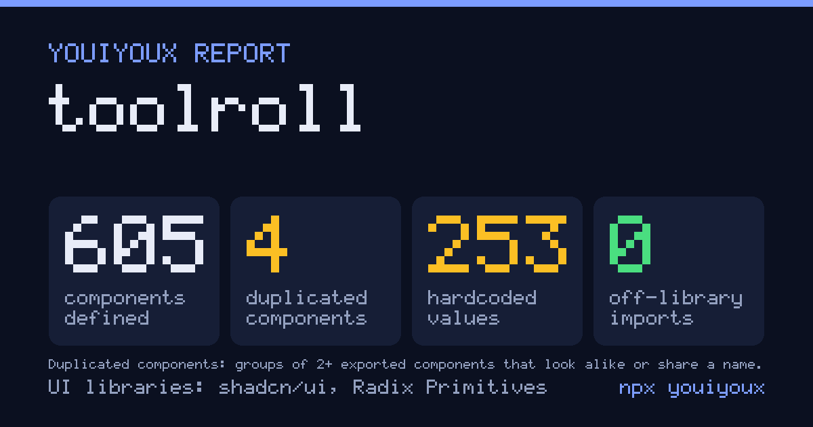
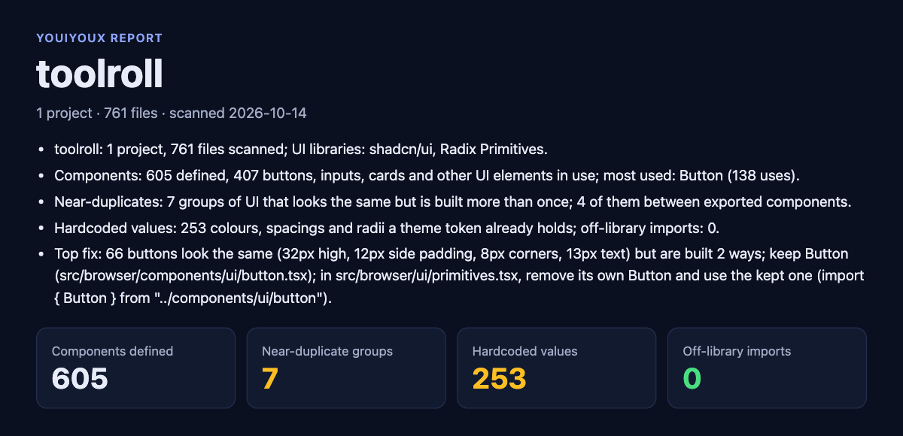

<p align="center">
  
</p>

# youiyoux

**Your agent rebuilds components you already have. youiyoux catches it.**

UI context and verification for coding agents: it tells the agent what your repo already has before
it writes UI, then checks what it wrote. Storybook is the workshop for people. youiyoux is for agents.

[](https://www.npmjs.com/package/youiyoux)
[](https://github.com/ap9000/youiyoux/actions/workflows/ci.yml)
[](LICENSE)

## Try it

```sh
npx youiyoux
```

In any repo. No config, no account. You get three files:

- `youiyoux-report.html`: the full report, one offline page
- `youiyoux-card.png`: the card above
- `youiyoux-summary.md`: paste it into a PR or issue



New to it? [Getting started](docs/getting-started.md): the report, the top fix, your agent and CI, in five steps.

## Use cases

- **Audit before a refactor.** Every near-duplicate, which copy to keep, and the files to change.
- **Stop your agent duplicating components.** After `npx youiyoux agents install`, it asks `ui_find_component` first.
- **Keep hardcoded colours out of PRs.** `npx youiyoux check --diff` names the token to use instead.
- **Share a UI health report.** Send the page or the card to your team or a maintainer.
- **Let your agent see what it built.** `npx youiyoux render <file>`: light and dark, desktop and phone, accessibility issues, a diff against main.
- **Turn the UI you have into a design system.** `npx youiyoux adopt`: your components and your stylesheet's variables become a System in your repo, with rules for your agent; `youiyoux system extract <dir>` moves it into its own repo when a second app needs it.

## What it finds

From Toolroll's console, 761 files:

```text
Near-duplicates: 7 groups of UI that looks the same but is built more than once; 4 of them between exported components.
Hardcoded values: 253 colours, spacings and radii a theme token already holds; off-library imports: 0.
Top fix: 66 buttons look the same (32px high, 12px side padding, 8px corners, 13px text) but are built 2 ways;
keep Button (src/browser/components/ui/button.tsx); in src/browser/ui/primitives.tsx, remove its own Button
and use the kept one (import { Button } from "../components/ui/button").
```

- **Near-duplicates**: components and hand-styled elements that look the same, and which one to keep.
- **Hardcoded values**: colours, spacing and radii your theme already has a token for.
- **Off-library imports**: an element from a library the rest of the code doesn't use.

## Set it up for your agent

```sh
npx youiyoux agents install   # rule in AGENTS.md + CLAUDE.md, MCP server for Claude Code + Codex
npx youiyoux hooks install    # check after each Claude Code edit, and at git commit
```

Your agent then has:

| | When |
| --- | --- |
| `ui_find_component` (MCP) | Before writing a component: the existing one, its import, props and a real usage |
| `npx youiyoux check --diff` | After UI edits: what the change adds, each with its fix. `--strict` fails CI |
| `ui_render` (MCP) | After changing a component: screenshots, accessibility issues, diff against base |

Undo with `npx youiyoux agents remove`. Agent reference: [docs/agents.md](docs/agents.md) and [llms.txt](llms.txt).

## How it works

- **Local.** Nothing is uploaded. No telemetry, no account.
- **Reads** source files, stylesheets, Tailwind config (read, never run), `package.json` and the lockfile; `.env` values only to strip them.
- **Writes** only the three files, to the repo or `--out <dir>`.
- **Draws** your most-used components with your own code and CSS in a local headless Chromium, if one is installed. `--render` offers to download it (~100 MB, once).
- **Safe to share.** It includes relative paths, component names, class lists, counts and rendered images when available. No source lines unless `--include-code`. Home paths, usernames, env values and credentials are stripped.
- Specimen images are cached in `~/.cache/youiyoux/specimens`, never in the repo.

Node 20 or later.

## Commands

<details>
<summary>All commands</summary>

| Command | Does |
| --- | --- |
| `youiyoux [path]` / `report` | The report. `--out`, `--render [--yes]`, `--include-code`, `--json` |
| `check --diff [base]` | What a change adds: near-duplicates, hardcoded values, off-library imports. `--strict`, `--json`, `--format github` |
| `render [file\|component]` | Draw a component: light and dark, 1280 and 390 px, axe, diff against base. `--base`, `--json` |
| `agents install\|remove` | Agent rule and MCP server. `--claude`, `--codex` (default both) |
| `hooks install` | Claude Code post-edit check and git pre-commit (default). `--ci [--diff]`, `--strict` |
| `mcp` | The stdio MCP server |
| `inventory` | Every UI element, grouped by shape. `--project`, `--include`, `--exclude`, `--json`, `--history` |
| `detect <repo\|url>` | Which UI libraries a repo or site uses |
| `discover "<need>"` | Outside components for a need (shadcn registries, npm); `discover sync` first |
| `adopt` | Make this repo's own components and stylesheet variables its design system, kept in the repo. `--dry-run` |
| `system extract <dir>` | Move an adopted System into a design repo of its own. `--package` |
| `init --design <dir>`, `sync`, `check`, `show`, `where`, `plan`, `migrate` | With a design system repo |
| `record`, `hub serve` | A team's hosted hub, read-only and fed by CI: every repository's products and each System's adoption by version. `hooks install --record` wires CI; [self-host it](docs/self-hosting.md) with Docker |
| `library ingest <link>` | Read a GitHub repo, a Storybook, a Figma file or a DESIGN.md into Library items, sorted by role; `--draft` files them for a person to keep, drop and approve. `figma login` signs in to Figma once |
| `upgrade` | Move to the design system's new release: the sync and its migrations, previewed and gated; `--write` applies all of it or nothing. `--to <tag>` for a git source |

Full reference: [docs/commands.md](docs/commands.md).

</details>

## Contributing

Node 24+, pnpm 10. `pnpm install`, then `pnpm typecheck` and `pnpm test`. Layout and rules:
[AGENTS.md](AGENTS.md). Releases are one command, `pnpm release patch` ([docs/releasing.md](docs/releasing.md)).

## License

[MIT](LICENSE)
