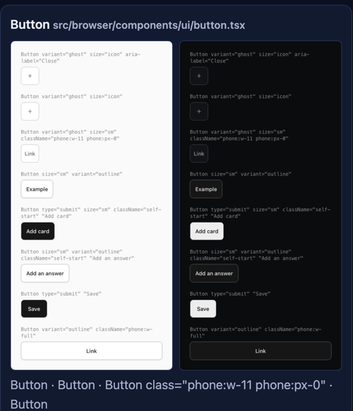

# youiyoux for coding agents

How an agent uses youiyoux in a repo: what to call, when, and how to read the answer. Examples are
real output from Toolroll's console. Setup is one command: `npx youiyoux agents install`.

## The loop

1. **Before writing a component**: call `ui_find_component` with the need in words. Reuse what it names.
2. **After UI edits**: run `npx -y youiyoux check --diff`. Apply each fix.
3. **After changing a component**: call `ui_render` with its file. Look at the images; fix new issues.

## The rule it installs

`agents install` writes this block to `AGENTS.md` and `CLAUDE.md` (between
`<!-- youi:agents:begin -->` and `<!-- youi:agents:end -->`; `agents remove` takes it out):

```markdown
## UI components (YouIyouX)

Before creating a UI component, call `ui_find_component` (MCP server `youiyoux`) with the need in words ("dismissible alert", "primary button with icon"): reuse the existing component it names, with its import and props; only when it says nothing fits, start where it says.

- Run from the repo root. After UI edits, run `npx -y youiyoux check --diff` (`--json` for data): it lists what your change adds that near-duplicates an existing component, hardcodes a value a token holds, or imports an element from a library other than the project's choice, each with its fix. Apply each fix.
```

It also registers the MCP server `youiyoux` in `.mcp.json` (Claude Code) and `.codex/config.toml`
(Codex). In a repo that has `@youiyoux/cli` as a dependency, the commands read `npx --no-install youiyoux`.

## MCP tools

All tools are read-only. None publish, approve, install or change anything.

| Tool | Call it | Input | Needs |
| --- | --- | --- | --- |
| `ui_find_component` | Before creating any UI component | `need` (words), `limit` (1-5) | Nothing |
| `ui_render` | After changing a component | `target` (file or component name), `base` (git ref) | A headless Chromium |
| `index_where_used` | Where an inventory family (`button-2`) is used | `family`, `project` | `youiyoux inventory` run once |
| `index_swap_impact` | What swapping a candidate in for a family would touch | `candidate` (`lib:` id), `family`, `project` | The local index |
| `index_rule_covers` | What a design rule covers | `rule`, `project` | `youiyoux scan` |
| `discover_search` / `discover_show` | Outside components for a need; references, never install | `need`, `role`, `limit` / `id` | `youiyoux discover sync` |
| `system_*`, `library_*` | Build with an approved design system | see the tool descriptions | `youiyoux init --design <dir>` |

### `ui_find_component`

Returns the project's existing components that fit, best first: import line, props, a real usage,
where it is used, and what it lacks. When nothing fits it says so and names where to start.

```text
> ui_find_component { "need": "dismissible alert" }

1 existing component in this project fits "dismissible alert" (looked at 605):
1. Use Alert (hand-rolled): import { Alert } from "src/browser/ui/primitives"; // from the project root: make it relative to your file
   Lacks: Alert has no dismiss prop (onDismiss/onClose). To add one: an optional onDismiss?: () => void that renders a close button calling it, in src/browser/ui/primitives.tsx.
   Why: name Alert: alert
   Props: tone: info|error, className
   Example at src/browser/app.tsx:618:
     <Alert className="so-demo-notice" data-demo-notice title={demo.text}>
     ...
   Used in 12 places: src/browser/app.tsx:618, src/browser/app.tsx:700, … (+10 more)
Next: import Alert as shown and reuse it instead of writing a new component; open src/browser/ui/primitives.tsx to confirm its props before using them. First add the missing capability in src/browser/ui/primitives.tsx as described above.
```

Do what `Next:` says. A `Lacks:` line means extend that component, not write a new one.

### `ui_render`

Draws the component's real usages with the project's own code and CSS: light and dark at 1280 and
390 px, axe accessibility issues (WCAG 2.2 A and AA), and a pixel diff against the base (default:
the merge base with `origin/main`). Returns absolute image paths: open them.

```text
> ui_render { "target": "src/browser/components/ui/badge.tsx" }

src/browser/components/ui/badge.tsx: 8 looks (Badge · Badge tone="attention" "waiting for you" · …), light and dark at 1280 and 390 px; from the cache: nothing it uses changed since it was last drawn
  light 1280: ~/.cache/youiyoux/specimens/shots/…/light-1280.png
  light 390: ~/.cache/youiyoux/specimens/shots/…/light-390.png
  dark 1280: ~/.cache/youiyoux/specimens/shots/…/dark-1280.png
  dark 390: ~/.cache/youiyoux/specimens/shots/…/dark-390.png
  before/after: unchanged since HEAD (40e742d): its files are the same there, so before and after match
  accessibility: 4 issues
    - Elements must meet minimum color contrast ratio thresholds (color-contrast, serious, 1 element in light): … [pre-existing: already at main (40e742d), not from this change]
    …
next: look at the screenshots; no new accessibility issues were confirmed; nothing to fix from this change
```

Fix issues marked new. `pre-existing` ones were there before your change; `specimen-only` ones come
from props the drawing could not supply. The CLI form is `npx youiyoux render <file> [--json]`.



## `check --diff`

Checks only what your change adds: the working tree against `HEAD`, or against the merge base with a
ref (`check --diff main`). New, untracked files count too.

```text
$ npx -y youiyoux check --diff
youiyoux check --diff against HEAD: 1 changed file
src/browser/components/save-button.tsx
  1:1  near-duplicate  SaveButton is a new button that looks like the existing Button (src/browser/components/ui/button.tsx:33): 32px high, 12px side padding, 8px radius, 13px text. Confirm it is the same role; if so, reuse the existing one instead of adding a component.
      → use <Button> from "./ui/button"
  3:84  hardcoded value  Hardcoded spacing gap-[8px]: the token spacing.spacing-phone-row or spacing.so-space-sm has this value.
      → use gap-[var(--spacing-phone-row)] (spacing.spacing-phone-row or spacing.so-space-sm)
note: Repository inference uses existing components, library imports and declared theme variables. Run `youiyoux init --design <dir>` to add design-system rules.

✖ 2 findings in this change: apply each fix (→), then run `youiyoux check --diff` again
```

Each finding is `line:column  kind  message`, then `→ fix`. Kinds: `near-duplicate`,
`hardcoded value`, `off-library import`, and `rule` when a design system is connected. Apply the
fix, run it again, stop when it reports nothing.

`--json` gives the same as data: `{ base, commit, files, findings, incomplete, gaps, notes, next, identity }`.
A finding's `kind` is `near-duplicate`, `hardcoded-value`, `off-library` or `rule`:

```json
{
  "kind": "near-duplicate",
  "file": "src/browser/components/save-button.tsx",
  "line": 1,
  "column": 1,
  "text": "SaveButton",
  "message": "SaveButton is a new button that looks like the existing Button (src/browser/components/ui/button.tsx:33): …",
  "fix": "use <Button> from \"./ui/button\"",
  "severity": "warn"
}
```

`--format github` writes PR annotations and a job summary. `incomplete: true` means part of the
check could not run: its findings are unknown, not zero.

### Hooks

`npx youiyoux hooks install` (default `--claude --git`):

- **Claude Code** (PostToolUse): after each Edit, Write or MultiEdit, the findings on the lines it
  added go back to Claude with their fixes. It never blocks; an edit that adds nothing is silent.
- **git pre-commit**: the same check on staged files. Advisory; `--strict` blocks new findings.
- `--ci [--diff]`: a GitHub workflow; with `--diff`, pull requests fail on findings they add.

Codex has no post-edit hook: it follows the AGENTS.md rule and meets the pre-commit hook.

## Exit codes

| Code | Means |
| --- | --- |
| 0 | Done. `check --diff` without `--strict` is advisory and exits 0 with findings |
| 1 | `check --diff --strict` found something or could not finish; `check` found errors; `render` drew nothing; a command failed |
| 2 | Usage error: unknown command or flag, a path that is not a directory, `--render` that needs `--yes` |

## JSON output

| Command | Flag |
| --- | --- |
| `youiyoux report` | `--json`: the report model (`youiyoux.report/1`) and the written file paths |
| `check --diff` | `--json`, or `--format github` |
| `check` | `--format json` |
| `render` | `--json`: every image path, issue and diff |
| `inventory` | `--json` (`youi.inventory/v1`) |
| `discover` / `discover show` | `--json` |
